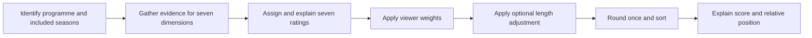

# Dynamic Rank Engine — ranking design reconstruction and review

**Research snapshot: 13 October 2026.** Public catalogue defaults; no signed-in account overrides. This document reconstructs Josh's intent from the original conversation, saved edits, methodology documents, reviews and current implementation. It is an analysis, not a new scoring policy or an instruction to overwrite assessments.

The strongest finding is that the original design is coherent: make seven distinct judgments about a precisely identified viewing experience, explain those judgments, then calculate a ranking according to the viewer's priorities. The current local calculation follows its declared inputs. The largest remaining weakness is the relationship between those inputs and their supporting reviews. The archive contains different scoring generations, inconsistent interpretations, unsupported facts and some explanations of the wrong programme.

My assessment is **8/10 for the underlying ranking concept and 4/10 for the current editorial evidence**. These are my judgments about the design and its support, not mathematical measurements. Seven dimensions provide a useful, understandable vocabulary. The evidence deserves a lower rating because 419 of 439 active entries have at least one category value that disagrees with their main archived review, and some reviews cannot support an assessment of the identified work at all. A mismatch alone does not establish which version is correct.

## 1. What I think you intended

You were building a discovery and comparison tool for television that feels consequential, immersive and memorable. The original conversation repeatedly moves from vague praise toward specific questions: do the characters feel autonomous; does the world continue beyond the plot; does the camera communicate; does the story advance with purpose; does it fulfil its promises?

You also wanted resistance to automatic prestige inflation. A famous actor, a fashionable show or a moving scene should not silently earn an exceptional score in every category. A five is ordinary competence, a seven is already very good, and a ten requires a convincing argument that the dimension could not meaningfully be improved. At the same time, you challenged ratings that became harsh without a sound comparison. Strictness was meant to improve calibration, not to manufacture a low average.

Your discussion of Kim Wexler is particularly revealing. You valued an interior life that the viewer can sense without receiving a complete explanation. Character complexity meant believable agency and contradiction, rather than exaggerated behaviour. Your defence of Breaking Bad's quieter material made the corresponding point about storytelling: a pause can contribute to momentum and meaning. Your final definition of resolution explicitly allowed coherent ambiguity.

I reconstruct the intended sequence as follows:



The judgments are editorial. The combination and ordering should be mechanical. Consistency means applying the same definitions and evidence standard across shows; it does not turn artistic judgment into a universal scientific truth.

**Primary evidence:** [original design conversation](<D:/DynamicRankEngine/_archived/old-archive/working-files/Entire Chat with Claude to Build Ranking System.txt>), especially lines 26–28, 77–121, 438, 1276–1296, 1354, 1760, 2373–2489 and 4049–4161. The source itself contains both Josh's messages and AI responses. Their authority is different.

## 2. Evidence hierarchy and how the design changed

I used this order when reconstructing intention:

1. Josh's explicit statements and corrections in the original conversation.
2. Saved edits under `josh-edits`, as evidence of actual chosen values and preferences. Their filenames and location provide provenance, although they do not prove who physically moved every slider.
3. The current application's code and catalogue, for what happens now.
4. Dated change records and methodological summaries, for subsequent evolution.
5. Agent directives and generated reviews, as historical interpretations that may contradict the stronger sources.

| Stage | What the evidence establishes | What it does not establish |
|---|---|---|
| Early conversation | Broad qualities included character, world, visuals, themes, scope and gravitas. | These early labels are not the final seven-dimensional rubric. |
| Final seven-category definition | Josh supplied the seven detailed definitions, including conceptual density and narrative path/resolution. | Later summaries cannot silently replace density with emotional depth or resolution with literal explanation. |
| Initial agreed seven weights | Josh corrected world building to 15% and path to 15%, then agreed to rescoring: **20/15/10/10/15/15/15**. | This is not today's default. |
| Four saved exports, 15–16 February 2026 | All retain those original seven weights. They contain 3, 2, 50 and 3 overrides respectively, with 103 base entries. | Every saved value is not necessarily a timeless public anchor; some later exports revise an earlier edit. |
| Change history, 16 February | Records characters increasing to 25%, path to 20%, camera and spectacle each decreasing to 5%. | The change log is an agent-written record; the original human conversation approving this later change was not found here. |
| Later directives/reviews | Several insist on “locked” foundation shows, half-point ratings, entry caps or immutable ranks. Some list weights totaling 105%. | These are not all rules Josh explicitly supplied. They also contradict one another. |
| Current local model | Uses **25/15/5/5/15/15/20**, totals 100%, calculates scores from inputs and sorts them. | A consistent calculation does not verify the artistic ratings or review facts. |

The later weighting therefore has real documentary history. It should not be described simply as an accidental corruption. Its important effect is clear: character and payoff now account for **45%**, while the two visual categories together account for **10%**. Originally those shares were 35% and 20%.

The severe “never move the top 100” language appears alongside records of an unwanted reranking that had to be restored. I infer that protecting carefully calibrated work was the underlying need. Freezing the ordinal positions is an unreliable way to protect that work: changing weights or adding a genuinely stronger show necessarily changes positions without changing any existing rating.

**Sources:** [saved exports](D:/DynamicRankEngine/docs/ranking-ledger/quantitative-audit.json), [change history](D:/DynamicRankEngine/_archived/memory/06-CHANGES.md), [scoring learnings](D:/DynamicRankEngine/docs/methodology/scoring_learnings.md), [repair directive](D:/DynamicRankEngine/data/core/CLEAN-AND-REPAIR-DIRECTIVE.md), [reranking report](D:/DynamicRankEngine/data/archive/DAILY-REPORT-2026-02-23.md).

## 3. The seven intended dimensions

### Characters & Acting

The central question is whether these feel like real individuals making their own choices. Evidence includes consistent motives, consequential decisions, an implied inner life, meaningful development and relationships that change what people do. A contradiction can strengthen a character if it is psychologically coherent. Mystery about someone's motives can be productive rather than a defect.

Acting supports that illusion. A conspicuous showcase performance is not automatically better than a restrained one. The important result is embodiment: the person on screen feels like the character, including when the writing gives them little dialogue.

The ensemble matters. Your Better Call Saul discussion challenged the assumption that two outstanding leads establish a perfect entire cast. However, I found no sound basis for turning that observation into a universal arithmetic rule that a two-lead programme can never exceed eight. The fair question is how fully the show's materially important people are realised, including the limitations of its supporting cast.

**Useful evidence:** an autonomous decision that surprises yet makes sense; behaviour carrying unspoken conflict; credible change across the assessed run. **Weak substitutes:** actor fame, an Emmy, a description of the plot, or calling every character “iconic.”

### World Building

A world should feel coherent and self-sustaining. Its institutions, rules, pressures and social relationships should make sense beyond the immediate scene. A viewer should understand how people survive, gain power, lose status and navigate the setting.

Fantasy lore is only one route to this. A convincingly rendered workplace, neighbourhood or legal system is eligible. The Wire is a central example because its institutions interact; Game of Thrones is an anchor because its cultures, histories and power structures make the setting feel extensive and inhabited.


**Useful evidence:** consequences of an established rule; institutions operating even when inconvenient for the protagonist; a culture affecting ordinary behaviour. **Weak substitutes:** counting locations, naming fictional factions, assuming historical accuracy, or equating expensive sets with a coherent society.

An unresolved mystery can make a world interesting, but cannot yet prove its eventual coherence. The evidence should separate what has been established from what a future season might explain.

### Cinematography

This evaluates how images communicate: composition, light, colour, movement, framing and visual rhythm. Your final definition puts coherence and meaning ahead of surface beauty. Recognisability from a single frame is a useful indicator of an authored visual language, not a mandatory technical test.

An ordinary room can be filmed exceptionally. A spectacular location can be filmed routinely. This distinction is essential to keeping cinematography separate from spectacle.

You also rejected giving old work a high score solely because it was impressive for its era. Historical influence can be discussed, but the intended comparison concerns what the viewer receives now. That does not require punishing old technology automatically; an older image may still communicate beautifully.

**Useful evidence:** framing that reveals a relationship, a visual pattern that develops with a character, clear intentional staging. **Weak substitutes:** budget, resolution, equipment, awards, or the generic assertion “it looks like a film.”

### Visual Spectacle

Your definition is broader than explosions and effects. It concerns the impact, ambition and sustained presence of what is shown: environments, material detail, design, visual novelty and immersion. You expressly included exposure to places, systems and ways of life the viewer rarely sees, including grounded realism.

This explains why your early Wire discussion supported spectacle around seven even without fantasy effects. It also explains why automatically assigning one or two to every domestic drama does not follow your original baseline. In the early calibration, everyday offices and homes were around five. A low score needs an argument about the delivered visual experience, not merely an absence of action.

Frequency matters. One striking episode is evidence of a peak; sustained presence supports a whole-run score. The camera's treatment of the material belongs under cinematography. The richness and novelty of the material presented belong here.

**Useful evidence:** a distinctive environment repeatedly made tangible; an unfamiliar social or material world rendered with authority. **Weak substitutes:** production cost, emotional intensity alone, or counting explosions.

### Conceptual Density

You deliberately replaced thematic resonance with this more precise idea. The question concerns **distinct ideas that the work actually dramatises, sustains and puts into interaction**. An issue named in dialogue is weaker evidence than an issue shaping several competing choices and institutions.

Depth and density are related, but they are not interchangeable. A deeply moving exploration of one idea may excel in character and path while having less conceptual breadth. Conversely, listing ten abstract nouns does not establish density if the story barely engages with them.

The original definition explicitly rejects relying on symbolic interpretation or tone. “This could represent modern alienation” is a critic's interpretation; “these characters face incompatible obligations created by work, class and family, and the plot makes those obligations collide” is stronger evidence.

The archive uses **Conceptual Depth** on 57 main pages. Several other pages retain the density label but justify it through emotional weight, complexity of plotting, or innovation in television format. Those measure different things.

**Useful evidence:** name the separate concepts, identify their dramatic carriers and show where they interact. **Weak substitutes:** sadness, moral seriousness, complexity for its own sake, interpretive symbolism or relevance to current news.

### Narrative Drive

This is purposeful forward movement through stakes, curiosity, tension and change. Speed is optional. A quiet conversation can transform the audience's understanding or make a later decision inevitable. A large action sequence can leave the story exactly where it started.

Your explicit defence of Breaking Bad's “Fly” is an important calibration point: an episode that breathes is not automatically filler. Repetition, stalling and resets deserve criticism when they fail to build anything; patient accumulation should be judged by what it achieves.

The review should identify the actual cause of a weak drive score: repeated situations without development, delayed information without payoff, redundant detours, unclear stakes, or an imbalance between setup and advancement. “Slow” alone is insufficient.

**Useful evidence:** what changes within an episode and across a season; how consequences create the next problem; why the viewer remains curious. **Weak substitutes:** number of twists, action frequency, bingeability alone, or an automatic penalty for quiet drama.

### Narrative Path & Resolution

This measures the relationship between a work's promises and its delivery across the assessed run. It includes the development of arcs and mysteries, the quality of their payoff, and whether later material strengthens or undermines what came before. It is wider than a finale score.

Your definition expressly permits intentional, coherent ambiguity. The relevant question is whether the ambiguity fulfils the work's promise. A show may resolve a character's conflict while leaving the wider world open. A police drama need not eliminate crime; a drama about an epidemic need not cure a real-world crisis.

Cancellation is a circumstance, not the assessment itself. An interrupted central story and a cancelled programme with a satisfying self-contained season are different experiences. Ongoing work likewise needs a stated assessed scope: completed seasonal promises can be judged now, while a long-term endpoint remains unknown.

Your saved Lost edit gives resolution **one**, alongside strong character and drive ratings. That is meaningful evidence that severe failure in this dimension can coexist with strengths elsewhere. It is not permission to apply an automatic low score to all ambiguous or unfinished work.

**Useful evidence:** name the important promise, show its development, explain the earned payoff or specific failure. **Weak substitutes:** a happy ending, every detail explained, popularity of the finale, or the fact that real life continues afterward.

## 4. Scale and calibration

| Score | Intended anchor | Practical interpretation |
|---|---|---|
| 10 | Cannot meaningfully improve the dimension | Requires unusually strong evidence and an explicit account of remaining limitations. |
| 9 | Almost perfect | Minor weaknesses remain; the claim is demanding. |
| 8 | Exceptional | Among the strongest examples within the dimension. |
| 7 | Very good | Memorable and clearly above ordinary competence. |
| 6 | Good | Noticeable strengths, with meaningful limitations. |
| 5 | Average | Competent, ordinary execution. |
| Below 5 | Below ordinary performance | Use for an identified weakness, not as an encoding of uncertainty. |

“99% perfect” in the original conversation is a qualitative anchor, not a calibrated probability. A numerical score of nine is not evidence of 99% factual certainty.

The current model accepts zero through ten and decimal ratings. The original conversation also allowed values such as 8.3 and 8.5. A later half-point-only directive is an interface/workflow convention, not a defining artistic principle. Displaying two decimal places after arithmetic should not imply that the underlying artistic judgment is accurate to one hundredth.

The sample is curated. A collection largely consisting of recommended television can legitimately cluster above five. Forcing its mean to five would redefine the scale as a percentile within this catalogue. The current means range from 5.839 for spectacle to 7.524 for characters; that is useful description, not by itself proof of inflation.

Calibration should use **dimension-specific anchors**. Breaking Bad can be a drive anchor without being the world-building maximum. A beloved show should be allowed a modest score in a dimension it does not strongly deliver. Disliking Mad Men, conversely, does not justify reducing every dimension when the evidence supports it. The original discussion explicitly recognised that distinction.

## 5. What the current calculation actually does

The application's public defaults are:

| Dimension | Weight | Change in weighted base for a one-point rating increase |
|---|---:|---:|
| Characters & Acting | 25% | +0.25 |
| World Building | 15% | +0.15 |
| Cinematography | 5% | +0.05 |
| Visual Spectacle | 5% | +0.05 |
| Conceptual Density | 15% | +0.15 |
| Narrative Drive | 15% | +0.15 |
| Narrative Path & Resolution | 20% | +0.20 |

For a show with seven ratings `s` and weights `w`:

```text
weighted base = sum(score × weight) / 100
adjusted value = weighted base × episode multiplier
displayed final = round adjusted value once, to two decimals
rank = position when displayed finals are sorted descending
```

The implementation applies a small tolerance at rounding boundaries to avoid binary floating-point artefacts. It does not round each contribution first. Equal displayed finals are ordered alphabetically by title using English locale comparison, and receive distinct ordinal positions. Thus #13 and #14 can be a tie in score rather than an assertion that one is measurably better.

There are **102 tied-score groups containing 360 of the 439 active shows**. This is a major interpretive constraint. A one-place difference often conveys no quality distinction at all.

The model calculates from current ratings; imported or catalogue `final`/`_final` snapshots do not replace the calculation. Moving a weight preserves the selected whole percentage and redistributes the remaining weights proportionally, using largest remainders to keep the total at 100. Personal rating overrides replace the corresponding baseline values before recalculation. Filtering selects from the already-ranked set, preserving global rank.

The catalogue has 442 records. Two aliases and one unverified entry are excluded, leaving 439 active entries. Three other entries already carry `premise-mismatch` review flags; their commentary is withheld by the interface, but their provisional ratings still contribute to the ranking.

The current detail view distinguishes the live score from the archived review. It shows the actual calculation and labels the old commentary as historical. However, it does not yet connect each live category rating to a matching, versioned justification. The old review's introduction is extracted for the disclosure; the complete archival analysis opens separately.

**Implementation evidence:** [ranking math](D:/DynamicRankEngine/ranking-math.js), [state model](D:/DynamicRankEngine/ranking-state.js), [detail view and archive loading](D:/DynamicRankEngine/app.js:189). All ledger ranks were produced through the actual application model, not by trusting stored rank fields.

## 6. The length adjustment is a substantial preference

| Current episode count | Multiplier |
|---|---:|
| 1–10 | 0.96 |
| 11–20 | 0.95 |
| 21–30 | 0.97 |
| 31–40 | 1.00 |
| 41–50 | 1.02 |
| 51–60 | 1.03 |
| 61–75 | 1.04 |
| 76–100 | 1.05 |
| 101+ | 1.06 |

Your motivation is clear: sustaining quality across a long run is difficult and valuable. You requested more graduated treatment than the earlier coarse approach, and accepted a miniseries discount. This is a real part of the intended design.

The original table treated **miniseries as a format** with a 0.96 multiplier, and separately listed short ongoing series. The current function knows only episode count. It does not receive format, completion status, runtime or assessed-season scope. A 12-episode completed miniseries therefore gets 0.95 today; the original semantic miniseries rule would give it 0.96.

Five consequences deserve explicit treatment:

1. **It changes the meaning of the final.** A show with every category rated eight receives 7.68 at ten episodes and 8.48 above one hundred. The difference is 0.80 despite identical editorial ratings.
2. **The first boundary is not monotonic.** Moving from ten episodes to eleven reduces the multiplier from 0.96 to 0.95. This follows the current table but is not a smooth reward for additional sustained quality.
3. **Episode count is a rough duration measure.** A short sitcom episode and a feature-length detective episode count equally. Specials, films and live events need an explicit scope policy.
4. **Longer does not itself prove sustained excellence.** The multiplier applies to weak long programmes as well. It rewards quantity after quality has been rated; it does not test consistency internally.
5. **The final is not strictly bounded by ten.** Ten in all categories multiplied by 1.06 produces 10.60. The current observed maximum is 9.53. A future interface should distinguish the ten-point dimension scale from an adjusted ranking index, or deliberately adopt a bounded rule.

With the current ratings and weights fixed, disabling length changes **427 of 439 ordinal positions**. This includes changes caused by other shows moving, so it is not a claim that all 427 undergo a major quality reversal.

| Show | Current final / rank | Without length | What this demonstrates |
|---|---|---|---|
| Game of Thrones S1–4 | 9.53 / #1 | 9.53 / #1 | Forty assessed episodes receive the neutral multiplier. |
| Band of Brothers | 8.52 / #8 | 8.88 / #4 | A strong ten-episode assessment loses positions through the short-run discount. |
| The Shield | 8.53 / #7 | 8.13 / #11 | Its long-run bonus puts it just above Band of Brothers. |
| Chernobyl | 7.75 / #51 | 8.08 / #12 | A modest numeric adjustment becomes a large ordinal movement in a dense field. |
| Buffy the Vampire Slayer | 8.24 / #13 | 7.78 / #49 | Length strongly benefits this long series. |
| Lost | 7.29 / #173 | 6.88 / #325 | Quantity still gives a bonus despite the baseline's severe resolution penalty. |

I would retain length as an explicit optional preference while showing the unadjusted quality score beside its effect. That preserves your original interest in sustained achievement and makes the trade-off reviewable. Changing its default or formula is a separate design decision; no such change is made by this audit.

## 7. Why particular shows currently rank where they do

### Game of Thrones S1–4: #1, 9.53

Its ratings are **10 / 10 / 8 / 9.5 / 9 / 10 / 9** in category order. The calculation is:

```text
2.500 + 1.500 + 0.400 + 0.475 + 1.350 + 1.500 + 1.800
= 9.525 × 1.00 = 9.525 → 9.53
```

It leads because it is exceptional across the heavily weighted dimensions, particularly character, world and drive. It receives no length bonus. The assessed object is explicitly the first four seasons; later seasons do not belong in this judgment. With the original seven weights and these same ratings, its final is 9.45. That difference is entirely explainable by weighting.

The archive also contains a different 9.45 justification whose printed contribution terms total 9.60 and then invoke an unspecified normalisation. A matching displayed number does not guarantee a matching derivation. The original master table's 9.50 is another historical figure and should not be silently treated as the current formula's answer.

### Breaking Bad: #2, 9.31

Ratings: **9 / 7 / 10 / 6 / 9 / 10 / 10**.

```text
2.250 + 1.050 + 0.500 + 0.300 + 1.350 + 1.500 + 2.000
= 8.950 × 1.04 = 9.308 → 9.31
```

Its strongest numerical support comes from character, drive and path. The modest spectacle score has little effect at the current 5% weight. Its 62-episode run adds 0.358 before rounding. The current vector agrees with the saved 16 February edit, while the main review prints a substantially different vector. The review therefore cannot be presented as a contemporaneous explanation of these current inputs.

### The Wire: #3, 9.19

Ratings: **9 / 9.5 / 6.5 / 8 / 10 / 7.5 / 9.5**. Weighted base 8.925; 60 episodes apply 1.03; final 9.19275 rounds to 9.19.

World, conceptual density and path compensate for comparatively lower camera and drive ratings. Breaking Bad's unadjusted base is only 0.025 higher; the two shows also fall in different length bands. Their ranking gap reflects both facts. The main review instead declares The Wire #1 with a different vector and final, which belongs to a different assessment generation.

### The Sopranos: #4, 9.11

Ratings: **9.5 / 8 / 6.5 / 5 / 9.5 / 8 / 9.5**. Weighted base 8.675; multiplier 1.05; final 9.10875 rounds to 9.11. This is the clearest demonstration that modest spectacle can coexist with a very high overall ranking under the current preferences.

An alternate review explicitly calls its ending perfect, then reduces its assessment because audiences were divided. Your definition instead asks whether the payoff is coherent and earned. That disagreement should be resolved at the rubric/evidence level, before recalculating anything.

### Lost: #173, 7.29

Ratings: **9 / 8 / 7.5 / 7.5 / 7 / 9.5 / 1**. A path score of one contributes only 0.20 at the current 20% weight. This is traceable to a saved edit and is a strong reason for its current position. Its long run then raises 6.875 to 7.2875.

Keeping everything else fixed and changing only path from one to eight would raise the pre-rounding adjusted score by **1.484**. This is an illustration of sensitivity, not a recommended new rating. A short-run or peak-season assessment of Lost would be a different object requiring its own seven judgments and episode count.

Every active entry has this arithmetic, neighbouring-score comparison, alternative-weight scenario and archival rationale excerpt in the [per-show ledger](D:/DynamicRankEngine/docs/ranking-ledger/per-show-ledger.md). The accompanying [JSON](D:/DynamicRankEngine/docs/ranking-ledger/show-ledger.json) preserves precise contributions and scenario values.

## 8. Where the evidence and rules have drifted

### Scores and reviews belong to different versions

The automatic comparison finds **419 active entries with at least one main-review category value absent from the current catalogue assessment**. There are also **11 main reviews with competing values for one or more categories inside the same page**. Examples include BEEF, Euphoria, Girls, Patrick Melrose and The Penguin.

Of 432 active main reviews with a conservatively extractable displayed final, **417 have no extracted final matching the current public-default calculation**. This is a version-consistency measurement. It is not evidence that 417 current calculations are incorrect, because ratings, weights, episode counts and length settings have changed.

Twenty-two main review grids list percentages totaling **105%**. The current calculator correctly requires 100%. These old grids are historical defects, not the live default.

### Explanation coverage is uneven

Of 457 main pages, labelled substantive rationale was found for all seven dimensions on 256 pages, six on four pages, three on 196 pages and none on one page. These counts concern explicitly associated explanations; a general synopsis may contain other relevant observations.

Godless contains seven “Content to be added” placeholders. BEEF mixes substantive analysis with another placeholder block and conflicting summary values. Fear the Walking Dead has damaged HTML that obscures its cinematography heading. Pachinko, Poker Face and The White Lotus print resolution N/A while displaying a numeric final and resolution weight. Those gaps must remain visible; missing evidence should not be silently converted into a score.

### The assessed viewing unit is inconsistent

Some entries identify a whole show; others identify a season or selected run. That can be useful for recommendations, but the review, count and scores must refer to the same unit. The 100 S1–5 and Vikings S1–4 state a limited scope, then criticise the selected run using later developments. Wallander blends two adaptations despite metadata identifying one. Twin Peaks includes The Return while The Return has a separate entry; overlapping recommendations require explicit labels rather than automatic duplicate removal.

The original conversation specifically supports Game of Thrones S1–4. It does not establish that every programme must automatically be cropped to whichever seasons produce the highest score. Later “peak seasons only” slogans go further than the clearest human evidence.

### Completion and ambiguity are applied inconsistently

Terriers is praised for a satisfying completed season despite cancellation. Other pages penalise cancellation automatically. Some ongoing programmes receive credit for completed seasonal promises; others get five because no final ending exists. The Leftovers can receive ten for intentional ambiguity while an alternate Sopranos review penalises divisiveness despite judging the ending perfect.

Dopesick and Extrapolations partly judge resolution by whether the real crisis is over. That changes the criterion from delivery of a narrative promise to success at solving the world outside the programme. A historical ending being known in advance is similarly not a defect under your stated rubric.

### Category boundaries are porous

Conceptual density becomes emotional depth; spectacle becomes the intensity of an actor's emotion; cinematography becomes the expense of the sets; drive becomes speed; path becomes whether all mysteries are literally explained. Some overlap is inevitable because the dimensions concern the same work. The problem is awarding or removing points for the same reason without explaining which distinct quality is being measured.

The clean distinction for a cancellation, for example, is: character depth describes what was achieved; drive describes how the existing material progresses; path describes which significant promises remain unfulfilled. Cancellation should not trigger a blanket downgrade across all three.

### Some supporting premises are demonstrably wrong

- **Pluribus:** the main review describes an anthology of eight different futures. Apple's official programme material describes a continuing story centred on Carol. The review cannot substantiate the identified programme's seven ratings. Its current public baseline is #438, 4.94. This establishes an evidence failure; it does not establish what the replacement score should be. [Apple programme page](https://www.apple.com/tv-pr/originals/pluribus/).
- **When Life Gives You Tangerines:** the review bases its judgments on a woman returning from career failure to run a tangerine farm. Netflix describes Ae-sun and Gwan-sik's life together across decades, with family and generational relationships. The review's central account does not match that work. Current public baseline: #373, 6.39. [Netflix's official guide](https://www.netflix.com/tudum/articles/when-life-gives-you-tangerines-release-date-news).
- **Museum of Innocence:** the review says 2023 and 45 episodes; the current catalogue has 2026 and eight. Netflix's announcement gives a nine-episode series premiering 13 February 2026. Correcting eight to nine would not cross a current multiplier boundary. This is a verified metadata conflict, not a complete factual audit of its review. [Netflix announcement](https://about.netflix.com/en/news/the-wait-is-finally-over-museum-of-innocence-premiering-on-netflix).

Other suspicious premises and cast claims are recorded as **unverified**, not silently promoted into factual corrections. Reading generated prose does not certify its claims about television, history or society. The review archive has not been externally fact-checked sentence by sentence.

### Protecting ratings was confused with protecting rank

The 103-show foundation remains valuable evidence of past calibration. Eighteen current entries differ in at least one category from its base-score map. Some differences may be legitimate later edits; that count does not identify unauthorised changes. Pluribus is a particularly large change across all seven dimensions, warranting a provenance review alongside its mismatched commentary.

The system needs to preserve who changed a judgment, the assessed scope, the evidence and the reason. It should derive the ordinal list each time. A protected baseline can coexist with freely adjustable personal weights.

## 9. The smallest design that would make this trustworthy

I would keep the seven dimensions and make the assessment record the centre of the product. A single coherent record should drive the slider values, explanatory text and calculated result.

| Record | Minimum information | Purpose |
|---|---|---|
| Programme identity | Stable ID, title, year, adaptation/version | Prevent confusion between remakes, similarly named works and related franchises. |
| Assessed scope | Included seasons/episodes, count, format, assessment date | Define exactly what the judgment and length adjustment concern. |
| Rubric version | Seven definitions and calibration references | Keep comparisons meaningful when the method evolves. |
| Seven assessments | Rating, concise reason, specific evidence, limitation | Make every input defensible without a wall of generic praise. |
| Evidence status | Verified identity; sufficient/provisional/withheld support; sources | Separate uncertain knowledge from low artistic quality. |
| Provenance | Author/source, prior version, reason for change | Preserve your calibration and make revisions reviewable. |
| Viewer preferences | Weights, personal ratings, length setting | Allow taste to vary without rewriting the public editorial assessment. |
| Derived result | Contributions, base, adjustment, final, tie information | Explain how the current settings produce the visible rank. |

No new category is needed. A compact explanation for each dimension can do more than a long generic review. The minimum useful rationale is: **what the show achieves, one or two concrete supporting observations, and what prevents a higher score**. It should identify scope when the evidence varies across seasons.

For an ongoing series, assess the promises made and completed within the named available run. Record that the overall endpoint remains unknown. Do not forecast a future ending into the score, and do not substitute a standard five or seven without saying that a separate provisional policy is being used. If completion preference is to be applied mechanically, make it an explicit preference rather than hiding it inside the artistic judgment.

For imported or historical reviews, retain the source and assessment version. Generate displayed totals from the associated vector and weights. The same title can legitimately have several historical opinions; the interface must say which opinion supplies today's score.

The public ranking should not imply that a withheld review makes its numerical inputs trustworthy. The first editorial action I recommend is to separate unsupported baseline assessments from defensible ones, preserving their historical values and all personal edits. That need not mean inventing new replacement ratings immediately.

## 10. Proposed implementation order

1. **Preserve the evidence.** Keep the original conversation, saved human edits, old vectors and this audit. Protect assessments and their histories instead of frozen rank numbers.
2. **Create one authoritative rubric.** Use your seven definitions verbatim as the foundation. Document the current default weights as a later configuration. Mark superseded 105% instructions and incompatible scope policies as historical.
3. **Resolve identity and viewing scope.** Start with verified premise mismatches, adaptation blends and selected-season/count disagreements. Correct metadata separately from artistic reassessment.
4. **Reconcile explanations with active inputs.** For each affected show, decide whether the supported version is the saved baseline, a later justified edit or a new assessment. Do not copy the most eloquent review's numbers automatically.
5. **Render the result from that assessment.** Show seven reasons, their contributions, the length effect and ties. A review total should never need to be manually kept in sync with a separately calculated score.
6. **Recalibrate a small anchor set.** Use representative cases: a rich ensemble, a narrow character study, grounded world-building, visual ambition, dense ideas, patient storytelling, an earned ambiguous ending and a cancelled but satisfying season. Then compare new entries one at a time.
7. **Retain targeted checks.** Validate seven ratings, 100% weights, scope/count consistency, one final rounding, stable tie handling and agreement between rendered evidence and the assessed version.

This sequence concentrates effort on trust. Changing the visual design again or adding more scoring dimensions would not repair an assessment written about a different programme.

## 11. What is established and what remains a judgment

**Established by current code/data:** the formula, active-entry count, contribution values, ordering rules, ties, length sensitivity and comparisons with archived values. The ledger uses the real application model and independently checks its public-default results.

**Strongly supported reconstruction:** your seven criteria, strict but meaningful scale, distinction between camera craft and visual material, permission for quiet momentum and earned ambiguity, interest in sustained quality, selected-season exceptions and desire for reasons beside ratings.

**Historically documented, with incomplete human approval provenance:** later default weights, various locks/caps, narrower eligibility rules and the transformation of semantic miniseries treatment into a count-only function.

**Not established:** that any particular show's artistic ratings are universally correct; that every archived factual claim is true; that every foundation difference was unauthorised; or that a mismatch means the current vector should be replaced by the old one. Exact numerical reproduction and reliable criticism are distinct requirements.

The current calculations answer **how** a show obtains its position. A defensible, versioned seven-part assessment is what will answer **why those input ratings deserve to be used**. Your original design already supplies most of the vocabulary needed to achieve that.

## 12. Coverage, reproducibility and ledger files

The full visible review bodies of **all 457 main pages** and **all 140 short alternative pages** were read. The original 4,610-line design conversation, four saved edit exports, principal methodology/directive documents, current calculation/state code and relevant review-rendering code were examined. Exact repeated alternative lines were omitted only with a stored source mapping.

The inventory also covers 200 backup review files and 38 old interface HTML files. After exact visible-text deduplication, the backup reviews add 79 distinct bodies and the interfaces add 13. All 219 additional distinct review bodies were mechanically analysed for available labelled scores and explanations. Selected long backup versions were read in full for historical comparison; the remaining long backups were inventoried and structurally analysed, not read sentence by sentence. The coverage records preserve that distinction. All 13 distinct interface text variants were read through their novel-line deltas.

This is a review of the local recovered project snapshot. It is not a fresh scrape of every production deployment or the user's signed-in personal ranking, and it does not claim direct viewing of hundreds of television series.

| File | Contents |
|---|---|
| [Human intent ledger](D:/DynamicRankEngine/docs/ranking-ledger/intended-design-ledger.md) | Requirement-by-requirement evidence, interpretation, confidence and conflicts. |
| [Per-show ledger](D:/DynamicRankEngine/docs/ranking-ledger/per-show-ledger.md) | All 439 active shows: inputs, contributions, final, neighbouring gaps, alternate settings, archival rationale excerpts and mismatch flags. |
| [Portable CSV](D:/DynamicRankEngine/docs/ranking-ledger/show-ledger.csv) | 442 catalogue rows, including the excluded records and their status. |
| [Exact numerical ledger](D:/DynamicRankEngine/docs/ranking-ledger/show-ledger.json) | Unrounded values, four scenarios, neighbouring scores and review-version links. |
| [Quantitative audit](D:/DynamicRankEngine/docs/ranking-ledger/quantitative-audit.json) | Counts, distributions, saved overrides and 18 foundation differences. |
| [Main review evidence](D:/DynamicRankEngine/docs/ranking-ledger/review-evidence.json) | Extracted values, substantive rationale paragraphs and internal conflicts for all 457 pages. |
| [Historical review evidence](D:/DynamicRankEngine/docs/ranking-ledger/historical-review-evidence.json) | Structural extraction from the 219 additional distinct review bodies. |
| [Reading notes](D:/DynamicRankEngine/docs/ranking-ledger/reading-notes.md) | Detailed primary reading observations and original conversation anchors. |
| [Continuation notes](D:/DynamicRankEngine/docs/ranking-ledger/reading-notes-continuation.md) | Remaining main/alternative review observations and explicit reading-coverage limits. |
| [Source inventory](D:/DynamicRankEngine/docs/ranking-ledger/source-inventory.json) | Main review paths, hashes and statuses. |
| [Additional inventory](D:/DynamicRankEngine/docs/ranking-ledger/additional-source-inventory.json) | Backup/alternate/interface paths, hashes and exact duplicate mapping. |
| [Source snapshot](D:/DynamicRankEngine/docs/ranking-ledger/audit-source-snapshot.json) | Hashes of the code, catalogue and methodological inputs used in this analysis. |
| [Verification results](D:/DynamicRankEngine/docs/ranking-ledger/verification.json) | Independent arithmetic checks, consistency checks and coverage totals. |

The two audit helpers write only ledger outputs. They do not update programme ratings, publish the website, contact an account or execute legacy maintenance jobs:

```powershell
python -X utf8 scripts/build-ranking-ledger.py
python -X utf8 scripts/build-ranking-ledger.py extras
python -X utf8 scripts/build-ranking-ledger.py deltas
python -X utf8 scripts/audit-ranking-design.py
python -X utf8 scripts/verify-ranking-ledger.py
```

Generated outputs describe the snapshot at the time they are rebuilt. Narrative findings should be reconciled deliberately when assessments or the rubric change.
